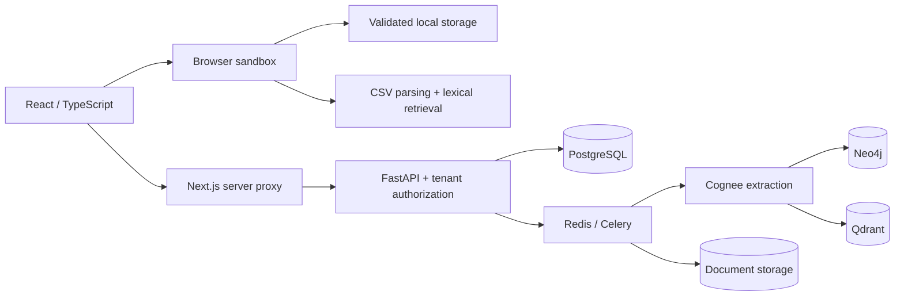

# TerraMind

**An agricultural evidence explorer with temporal knowledge graphs and reproducible ML evaluation.**

TerraMind connects field records across time so users can inspect what was recorded,
where it came from, and which relationships remain unconfirmed. The public sandbox
opens immediately—no account, backend, or API keys required.

## Try it locally

Requires Node.js 22+ and npm:

```sh
cd frontend
npm ci
npm run dev
```

The home page provides three synthetic fields, an interactive graph, a record
timeline, document review, and evidence-linked local search. Changes persist in
browser storage when available; Settings → Reset demo data restores the samples.
The optional `/live` workspace connects to the private farm API. See
[deployment](DEPLOYMENT.md) for backend services and provider configuration.

## A five-minute walkthrough

1. Open Field B and inspect the documented yield change on its dashboard.
2. Open Knowledge Graph, select a node, drag it, filter by type/date, and export
   the visible graph. Links distinguish stored records from agronomic claims.
3. In Ingest & Review, download one of the labeled synthetic CSVs. Upload a CSV
   with your own observations, for example:

   ```csv
   date,rainfall_mm,note
   2026-09-30,15,Light rain after irrigation
   ```

4. Open Ask TerraMind and search for `rainfall`. The answer cites matching ready
   records and includes parsed CSV rows. Switch fields to verify record isolation.
5. Upload an image to exercise manual review, then reload to verify saved state.

Local search is deterministic keyword retrieval, not an LLM. CSV files are parsed
in the browser with limits of 256 KB, 500 data rows, and 128 KB parsed output.
PDF and image uploads create metadata records; local OCR is not implemented.
Nothing in this sandbox proves causation or recommends chemical dosages.

## Engineering design



- **Interactive visualization:** force layout, node dragging, anchored zoom,
  selection, date/entity filters, reduced motion, and JSON export.
- **State integrity:** field-scoped records, validated browser snapshots, recovery
  from malformed state, and explicit persistence-failure messaging.
- **Private API:** farm/plot authorization, HttpOnly cookie handling, token refresh,
  same-origin write checks, rate limits, and evidence-scoped corrections.
- **Evidence discipline:** pending documents remain visible as records; causal
  confirmations require explicit human action and endpoint scope checks.
- **Operational separation:** the sandbox runs independently. Real ingestion needs
  storage, workers, graph/vector services, OCR, and model providers.

## Verification

```sh
cd frontend
npm run check
```

This runs lint, unit tests, TypeScript, production build, API proxy smoke tests,
and Chromium interaction tests. Chromium is selected from `CHROMIUM_PATH`,
`/usr/bin/chromium`, or the installed Playwright browser. To install the latter:
`npx playwright install --with-deps chromium`.

```sh
# From the repository root:
python -m unittest discover -s checks -v
cd backend
python -m venv .venv
.venv/bin/pip install -r requirements.txt
.venv/bin/python -m pytest -q
```

Backend tests use SQLite and mocked external providers. Browser tests exercise the
real built frontend with mocked private API responses. Passing them does not
establish availability of real provider services. CI runs these checks on pushes
and pull requests.

## ML evaluation

The yield model uses a temporal split: 16,299 training rows through 2016 and
3,225 held-out rows from 2017–2020, after merging crop, soil, and weather data.
Categorical vocabularies use training years only, with unknown categories mapped
to -1. A fixed seed and mean baseline make the evaluation reproducible.

| Model | Held-out R² | RMSE | MAE |
|---|---:|---:|---:|
| Mean baseline | -0.0011 | 14.4138 | 5.4791 |
| Random Forest | 0.6099 | 8.9980 | 1.5755 |
| Gradient Boosting | 0.6360 | 8.6911 | 2.0435 |
| Mean ensemble | 0.6317 | 8.7429 | 1.7223 |

These are mixed-crop aggregate scores, not per-field guarantees. Annual weather
and input totals must be available at inference time; this is not a pre-season
forecast. The models are research scripts and are not served by the dashboard.
See the [model card](docs/MODEL_CARD.md) and
[machine-readable metrics](outputs/reports/model_metrics.json).

```sh
python -m venv .venv-ml
.venv-ml/bin/pip install -r requirements_ml.txt
TERRAMIND_OUTPUT_DIR=/tmp/terramind-ml .venv-ml/bin/python ml_models/yield_predictor.py
.venv-ml/bin/python -m unittest discover -s tests_ml -v
```

`TERRAMIND_OUTPUT_DIR` keeps newly trained artifacts separate from committed model
files. Only load joblib artifacts from trusted sources.

## Repository map

| Directory | Purpose |
|---|---|
| `frontend/` | Next.js sandbox and optional private workspace |
| `backend/` | FastAPI, data models, workers, integrations, and API tests |
| `ml_models/` | Temporal yield evaluation, anomaly detection, pattern mining |
| `data_analysis/` | Exploratory analysis scripts |
| `cognee_pipeline/` | Offline/online graph ingestion and query examples |
| `checks/`, `tests_ml/` | Isolated regressions and ML evaluation checks |
| `outputs/` | Historical artifacts and current yield evaluation report |

The synthetic sample library contains 18 CSV documents across three fields, with
every row labeled fictional. It is a demonstration dataset, not farming advice.
